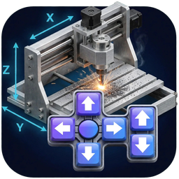
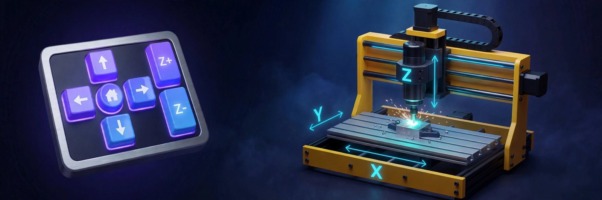
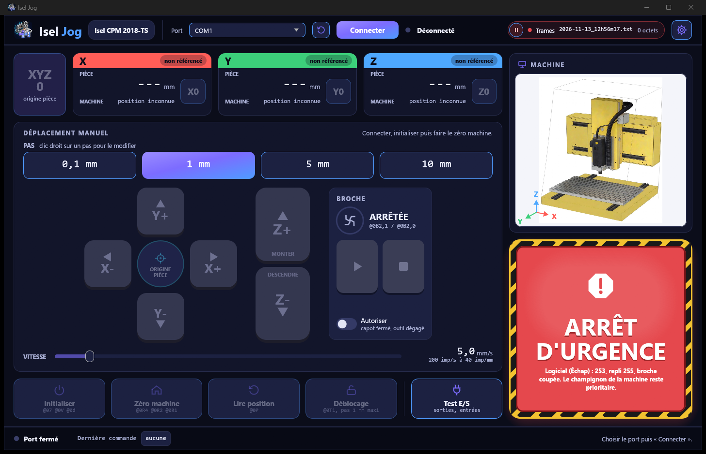

  

<h1 align="center">Isel Jog</h1>

  <b>Déplacement manuel et capture des échanges série pour la fraiseuse Isel CPM 2018.</b> 
  <i>Manual jog and serial traffic capture for the Isel CPM 2018 milling machine.</i>

  
  
  

  

## Présentation / Overview

Isel Jog pilote une fraiseuse **Isel CPM 2018** reliée en USB-série :

- déplacement des axes X, Y, Z avec pas de 0,1 / 1 / 5 / 10 mm
- origine pièce flottante, positions pièce et machine affichées
- enregistrement des trames envoyées et reçues pour étudier les réactions de la machine

*Isel Jog drives an Isel CPM 2018 milling machine over USB-serial: X/Y/Z jog with selectable steps, floating work origin, and recording of all serial frames in both directions.*

   
  Version de développement / Development build

## Statut / Status

En développement, pas encore diffusé : le code sera publié ici avec la première version utilisable.

*In development, not yet released: the source code will be published here with the first usable version.*

## Liens / Links

- Site : [iseljog.fe-be.fr](http://iseljog.fe-be.fr)
- Contact : iseljog@fe-be.fr
- Soutien / Support : [Patreon FeBeSoft](https://www.patreon.com/c/FeBeSoft) (le logiciel est et restera gratuit / the software is and will remain free)

Licence prévue / Planned license : GPL-3.0

---

Un projet <a href="https://fe-be.fr">FeBe</a> - logiciels libres pour makers

